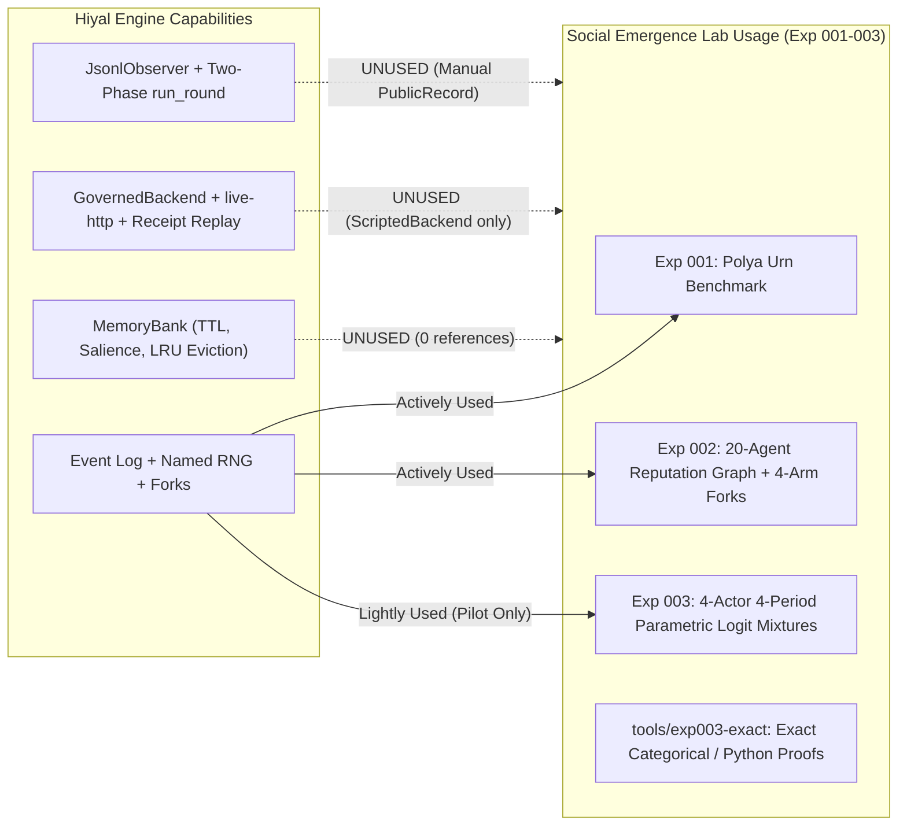

# Project Review & Sociology Research Agenda: Hiyal + Social Emergence Lab

**Review date:** 2026-11-23  
**Status:** Internal AI-assisted architectural and research-portfolio review — **not** external human academic peer review (V5), formal R-05 six-dimension scoring, a frozen study protocol, or authorization for new simulations, CI runs, or human-subject studies.  
**Reviewed baselines:** `social-emergence-lab` at `9f15040ca1720de4342b3b86884d2e8ab897e0d4` ([README](../../README.md)) and pinned [`hiyal`](https://github.com/davletovb/hiyal/blob/050d1de094f5d0813817e2020ec5c5da97d5c42e/README.md) at `050d1de094f5d0813817e2020ec5c5da97d5c42e`.

> [!WARNING]
> **Time-sensitive evidence custody alert (as of 2026-11-23):**
> - **2026-11-25 (2 days away):** Original GitHub Actions artifacts for Experiment 003's 24-society exploratory pilot are documented as expiring ([Experiment 003 README](../../experiments/003-cooperation-mechanism-recovery/README.md#L62)).
> - **2027-01-19 (~8 weeks away):** Original Actions archives for Experiment 001 ([Issue #6](https://github.com/davletovb/social-emergence-lab/issues/6)) and Experiment 002 V1/V2 ([Issue #14](https://github.com/davletovb/social-emergence-lab/issues/14), [Issue #17](https://github.com/davletovb/social-emergence-lab/issues/17)) are scheduled to expire ([current-research-status.md](../current-research-status.md#L19-L25)).
>
> If long-term provenance of original journals matters, export/publish them to GitHub Releases or a DOI-backed archive (e.g., Zenodo) before expiry.

---

## Part 1: Project Review & Structural Diagnosis

### 1.1 What Is Exceptionally Strong

Across both repositories, this ecosystem displays a level of engineering and epistemological discipline that is rare in agent-based modeling (ABM) and computational social science:

1. **Verifiable counterfactual simulation kernel ([`hiyal`](https://github.com/davletovb/hiyal/blob/050d1de094f5d0813817e2020ec5c5da97d5c42e/src/lib.rs)):**
   - Pure Rust (`#![forbid(unsafe_code)]`), deterministic named ChaCha20 RNG streams, append-only SHA-256 hash-chained event logs, exact `float_roundtrip` replay, and in-place staging via [`apply_undoable`](https://github.com/davletovb/hiyal/blob/050d1de094f5d0813817e2020ec5c5da97d5c42e/src/core.rs#L187-L196).
   - **First-class paired counterfactual forks** ([`fork_at_head`](https://github.com/davletovb/hiyal/blob/050d1de094f5d0813817e2020ec5c5da97d5c42e/src/research.rs#L506) and [`paired_forks`](https://github.com/davletovb/hiyal/blob/050d1de094f5d0813817e2020ec5c5da97d5c42e/src/research.rs#L649)) with portable copied parent ancestry, verified setup closures ([`create_with_setup`](https://github.com/davletovb/hiyal/blob/050d1de094f5d0813817e2020ec5c5da97d5c42e/src/experiment.rs#L214)), and tamper-checked fork views.
   - **Bounded structured agent memory** ([`MemoryBank`](https://github.com/davletovb/hiyal/blob/050d1de094f5d0813817e2020ec5c5da97d5c42e/src/memory.rs#L28-L36)): logical-step TTL expiration, importance/salience weighting (0–1,000), access-count reinforcement, and deterministic LRU/importance eviction.
   - **Governed external model/tool boundaries** ([`GovernedBackend`](https://github.com/davletovb/hiyal/blob/050d1de094f5d0813817e2020ec5c5da97d5c42e/src/guard.rs#L87), [`BudgetConfig`](https://github.com/davletovb/hiyal/blob/050d1de094f5d0813817e2020ec5c5da97d5c42e/src/guard.rs#L20), keyed durable receipts for strict offline replay, and [`run_round`](https://github.com/davletovb/hiyal/blob/050d1de094f5d0813817e2020ec5c5da97d5c42e/src/experiment.rs#L586) two-phase concurrent execution).
   - **Privacy-conscious observability** ([`JsonlObserver`](https://github.com/davletovb/hiyal/blob/050d1de094f5d0813817e2020ec5c5da97d5c42e/src/observe.rs#L101-L104) and [`EventSummary`](https://github.com/davletovb/hiyal/blob/050d1de094f5d0813817e2020ec5c5da97d5c42e/src/observe.rs#L21-L40)) separating redacted projections from sensitive internal journals.

2. **Anti-hype scientific culture ([scientific-validation-and-research-discovery-plan.md](../scientific-validation-and-research-discovery-plan.md)):**
   - Strictly distinguishes **V1–V5 evidence tiers** (implementation replay ≠ within-model causation ≠ mechanism identification ≠ human validity ≠ external peer review).
   - Treats **societies / parent seeds**—never agent-steps or dependent forks—as the independent statistical unit ([methodology.md](../methodology.md#L4-L6)).
   - Elevates **negative results** (Exp 002 V3: no active regeneration cell; slow relaxation + unexpected turnover compensation) and **structural non-identification** (Exp 003: `M ⊆ all`, `S ⊆ N ⊆ L`, set-valued recovery instead of forced classification, candidly rejecting the flawed T1 cross-actor Hankel proof for `N ⊄ S`) into primary scientific outputs.
   - Preserves temporal provenance strictly—never retroactively relabeling exploratory runs as preregistered ([documentation-reconciliation-20261028.md](../documentation-reconciliation-20261028.md)).

---

### 1.2 Four Deep Structural Tensions

Despite those strengths, reviewing both repositories side by side reveals four important structural tensions:

#### Tension 1: The Capability Chasm Between `hiyal` and `social-emergence-lab`
An import audit of `src/` and `tests/` confirms that the lab uses `World`, `Trial`, `Streams`, `Store`, and `fork_at_head`, while using **zero** of Hiyal's R3–R6 primitives: [`MemoryBank`](https://github.com/davletovb/hiyal/blob/050d1de094f5d0813817e2020ec5c5da97d5c42e/src/memory.rs#L28-L36), [`GovernedBackend`](https://github.com/davletovb/hiyal/blob/050d1de094f5d0813817e2020ec5c5da97d5c42e/src/guard.rs#L87), `live-http`, [`run_round`](https://github.com/davletovb/hiyal/blob/050d1de094f5d0813817e2020ec5c5da97d5c42e/src/experiment.rs#L586), and [`JsonlObserver`](https://github.com/davletovb/hiyal/blob/050d1de094f5d0813817e2020ec5c5da97d5c42e/src/observe.rs#L101-L104). Ironically, Hiyal has grown into a sophisticated cognitive/hybrid-agent simulation engine just as `social-emergence-lab` has narrowed toward 4-actor, 2-to-4-period analytical mixture proofs in `tools/exp003-exact` that barely need a simulation engine at all.

#### Tension 2: The "Micro-Formalism Trap" in Experiment 003
Experiment 003 ([`experiment003.rs`](../../src/experiment003.rs#L20-L133), [a2-v022-joint-law-hierarchy-20261025.md](../research/r06/a2-v022-joint-law-hierarchy-20261025.md)) asks a genuinely deep methodological question—*when are competing cooperation theories only set-identified?*—and has produced sharp author-side results (random-rematching invariance for `C`, temporal stationarity separating `L`/`R` from `M`/`N`/`S`, and fine-monotonicity reversal for `R` vs. `L` under `A`).

However, there is a sociological hazard: several of the witnessed population-law total-variation separations are tiny—for instance, `TV(P_R, P_L) ≥ 4.93 × 10⁻⁵` under policy `A` and `TV(P_C, P_m) ≥ 0.0047` ([remaining-h4-pair-invariants-20261027.md](../../experiments/003-cooperation-mechanism-recovery/remaining-h4-pair-invariants-20261027.md#L83), [cl-random-broker-certificate-20261027.md](../../experiments/003-cooperation-mechanism-recovery/cl-random-broker-certificate-20261027.md#L108)). While mathematically valid for existence of non-inclusion, **sociologists will rightly ask two questions**:
1. *Practical identifiability:* If separating two mechanisms requires $K \sim 10^5\text{–}10^8$ independent societies, they are *statistically indistinguishable* in any conceivable human or field study—meaning the *non-identification frontier* is actually far more sociologically consequential than proving tiny asymptotic separations.
2. *Substantive scope:* Spending months resolving every corner of 6 hand-written logit equations risks turning a sociology lab into an econometrics exercise over one synthetic functional form unless the framework is explicitly bridged back to substantive theory or real/LLM behavioral agents.

#### Tension 3: Verification Paralysis vs. Scientific Closure
The lab's self-critique is a superpower, *up to a point*. Right now, every experiment sits in an unfinished limbo:
- **Exp 001:** Completed benchmark with an unregistered confirmatory draft (not worth registering as a Pólya urn; best formally closed as a calibration suite).
- **Exp 002:** Actually contains a **fascinating, substantive discovery**—not just "no active regeneration," but *negative matched new-link/selection exposure under fast selective deletion* (`m = 2`: `−0.0747`, 95% CI `[−0.1195, −0.0299]`; [experiment-002-v3-critical-reanalysis-20261022.md](experiment-002-v3-critical-reanalysis-20261022.md#L23))—yet it has remained frozen awaiting external review ([Issue #22](https://github.com/davletovb/social-emergence-lab/issues/22)) instead of probing *why* fast turnover compensated.
- **Exp 003:** Blocked at [Issue #65](https://github.com/davletovb/social-emergence-lab/issues/65) on recruiting an isolated external mathematical reviewer before moving forward, while R-05's six other candidates were all stalled because their original single-operator formulations hit either empirical prior art (Bursztyn 2020, Smerdon 2020, Dickson 2022, Howe 2016, Petersen 2000, Bail 2018, van de Rijt 2014/2019) or elementary single-variable aliasing (`g + v` in Candidate C; common shock in Candidate D).

#### Tension 4: Two Small Engine Gaps in Hiyal That Matter for Future Sociology
When designing multi-horizon sociological counterfactuals, two documented Hiyal limitations become bottlenecks:
1. **Head-only forking** ([r2-engine.md](https://github.com/davletovb/hiyal/blob/050d1de094f5d0813817e2020ec5c5da97d5c42e/docs/r2-engine.md#L76)): `fork_at_head` forks only at the latest committed event rather than an arbitrary historical logical step $\tau$. Supporting replay-to-$\tau$ branching would allow *intervention-timing sweeps* (e.g., comparing truth correction or record expungement at $\tau \in \{50, 150, 300, 600\}$ off one verified parent trajectory).
2. **No verified stochastic RNG contract for `run_round`** ([r6-review-remediation.md](https://github.com/davletovb/hiyal/blob/050d1de094f5d0813817e2020ec5c5da97d5c42e/docs/r6-review-remediation.md#L16)): Simultaneous-action social games (norm tipping, institutional voting, concurrent LLM rounds) need a clean deterministic RNG contract for two-phase rounds.

---

## Part 2: Seven Meaningful & Interesting Sociology Research Ideas

Every idea below is designed to pass the lab's own [R-05 / validation rubric](../scientific-validation-and-research-discovery-plan.md#L135-L145):
- **Substantively sociological** (connects to core theoretical debates in stratification, networks, organizations, collective memory, institutions, and algorithmic society).
- **Non-duplicative** of the prior art already audited in R-05 and Exp 002.
- **Sharp mechanism discrimination** via a **common physical intervention** and a **tractable tiny-world exact oracle** (2–8 actors).
- **Valuable even under a negative or set-identified result** (honest S vs. E claim boundaries).

---

### Idea 1: Network Saturation Rebound vs. Triadic-Closure Lock-In
*(Directly resolves and elevates Experiment 002's V3 anomaly)*

- **Sociological question:** After an arbitrary early reputational distortion is truthfully corrected, **why does fast selective network turnover sometimes *reverse* legacy inequality (compensatory rebound) rather than reinforce it—and what tie-formation topology turns passive structural memory into true active regeneration?**
- **Core theoretical insight:** Experiment 002 V3 ([experiment-002-v3-critical-reanalysis-20261022.md](experiment-002-v3-critical-reanalysis-20261022.md#L22-L23)) stumbled onto a striking post hoc pattern: under fast lowest-belief deletion (`m = 2`), post-correction new-link + selection exposure was **negative** (`−0.0747`). A compelling structural hypothesis is **simple-graph eligibility headroom**: when advantaged Group H already holds many incoming links in a bounded-degree simple graph, they are *saturated* (ineligible as duplicate replacement targets), so post-correction global search disproportionately draws replacements from previously excluded Group L. By contrast, under **triadic-closure / friend-of-a-friend referral search**, excluded actors are structurally *unreachable* at 2 hops—blocking eligibility headroom and converting passive structural carryover into **true post-correction active regeneration**.
- **Competing microscopic mechanisms (on the exact same pre-correction checkpoint graph via [`fork_at_head`](https://github.com/davletovb/hiyal/blob/050d1de094f5d0813817e2020ec5c5da97d5c42e/src/research.rs#L506)):**
  1. **Global reputation-preferred replacement** (Exp 002 baseline; predicts *compensatory rebound* at high churn due to candidate-set saturation).
  2. **Triadic-closure / 2-hop referral replacement** (predicts *positive active regeneration* because reachability exclusion outlives belief correction).
  3. **In-degree / visibility-weighted replacement** (preferential attachment on structural visibility; predicts continuing lock-in independent of beliefs).
  4. **Random-replacement null** (pure exponential structural relaxation).
- **Common physical intervention:** Same false-prior pre-history → truthful belief correction at $\tau$ crossed with replacement-search rule (global vs. triadic vs. degree-weighted) and graph repair control.
- **Exact tiny-world oracle:** 6- or 8-actor directed graph with exact analytical candidate-set transition probabilities proving the exact sign flip between global saturation rebound and triadic reachability lock-in.
- **Prior-art differentiation:** Directly advances beyond Frey & van de Rijt (2016), van de Rijt (2019), Tsvetkova (2021), and Petersen et al. (2000) by isolating **search-horizon topology (global market vs. 2-hop referrals)** as the phase switch between *self-correcting saturation rebound* and *self-regenerating exclusion* after truth correction.
- **Lab fit & cost:** **Lowest engineering cost / fastest scientific payoff.** Reuses [`reputation.rs`](../../src/reputation.rs) and [`reputation_pilot.rs`](../../src/reputation_pilot.rs) almost out of the box, directly answers [Issue #19](https://github.com/davletovb/social-emergence-lab/issues/19), and gives [Issue #22](https://github.com/davletovb/social-emergence-lab/issues/22) a dramatically stronger novelty case before external sociological review.

---

### Idea 2: Institutional Amnesia vs. Salience Traps ("The Paradox of Bounded Social Memory")
*(First flagship scientific consumer of Hiyal's unused [`MemoryBank`](https://github.com/davletovb/hiyal/blob/050d1de094f5d0813817e2020ec5c5da97d5c42e/src/memory.rs#L28-L36))*

- **Sociological question:** Societies debate "right to be forgotten" laws, sealed juvenile/credit records, and digital permanence (Goffman on stigma; Lageson 2020 *Digital Punishment*; Mayer-Schönberger). **Does bounding memory accelerate redemption after an early negative shock or false stigma—or can salience-reinforced capacity limits actually *worsen* stigma lock-in relative to an infinite archive?**
- **Core theoretical insight:** Compare three fundamentally different sociological memory regimes—all natively expressible in [`MemoryBank`](https://github.com/davletovb/hiyal/blob/050d1de094f5d0813817e2020ec5c5da97d5c42e/src/memory.rs#L28-L36):
  1. **Infinite archive (unweighted history):** Early stigma is diluted at rate $O(1/t)$ by subsequent benign/positive evidence (classical self-correction).
  2. **Statutory TTL expungement (`expires_at`):** Hard expiration after $L$ logical steps yields discontinuous redemption—*unless* network ties formed prior to expiry preserve structural exclusion (bridging directly to Exp 002).
  3. **Salience-reinforced bounded memory (`capacity` + `importance` + `reinforce` + LRU eviction):** A high-salience early negative event (scandal, criminal mark, viral rumor) gets retrieved repeatedly during screening, boosting its `accesses` and refreshing `accessed_step`—causing it to **permanently occupy bounded memory slots and evict low-salience routine positive redemption signals**.
- **Surprising falsifiable prediction:** There exists a sharp parameter regime where **finite-capacity salience memory creates strictly worse, longer-lasting stigma inequality than an infinite archive**, whereas **hard TTL expungement** breaks the salience trap unless structural ties already hardened around the stigmatized actor.
- **Common physical intervention:** Fork identical post-stigma histories via [`paired_forks`](https://github.com/davletovb/hiyal/blob/050d1de094f5d0813817e2020ec5c5da97d5c42e/src/research.rs#L649) into: (a) infinite archive, (b) statutory TTL expungement, (c) salience-capped memory without TTL, (d) TTL + tie repair.
- **Exact tiny-world oracle:** 2-actor or 4-actor exact finite Markov chain over `MemoryBank` capacity $K \in \{2, 3\}$ slots with binary/weighted signals—closed-form hitting time to redemption across regimes.
- **Negative-result value:** Even if salience trapping requires implausibly high asymmetry between negative and positive importance weights, mapping the exact phase boundary between *dilution*, *expungement*, and *salience capture* is a clean theoretical contribution to sociology of stigma, reputation governance, and platform design.

---

### Idea 3: Mechanism Identification of LLM Artificial Societies
*(Bridges Experiment 003's identification paradigm + Hiyal's unused [`GovernedBackend`](https://github.com/davletovb/hiyal/blob/050d1de094f5d0813817e2020ec5c5da97d5c42e/src/guard.rs#L87) & receipt replay)*

- **Sociological question:** Hundreds of recent computational social science papers simulate human societies with LLM agents and report emergent "cooperation," "norms," or "polarization" (e.g., Park et al. 2023; Bail 2024 *PNAS*). **Do LLM agents in repeated social dilemmas actually instantiate distinguishable sociological mechanisms (conditional reciprocity, social belief learning, contextual reinforcement)—or do their observable public trajectories collapse into prompt-conditioned static preferences (`Family N`), material baselines (`Family M`), or framing artifacts that violate every classical behavioral model?**
- **Why this ecosystem is uniquely built to answer this:**
  - `social-emergence-lab` already owns the **Experiment 003 six-family set-valued identification testbed** (`M, N, C, S, L, R`) with strict public-only observability ([`experiment003.rs`](../../src/experiment003.rs#L20-L133)).
  - `hiyal` already owns [`GovernedBackend`](https://github.com/davletovb/hiyal/blob/050d1de094f5d0813817e2020ec5c5da97d5c42e/src/guard.rs#L87) (micro-USD spend caps via [`BudgetConfig`](https://github.com/davletovb/hiyal/blob/050d1de094f5d0813817e2020ec5c5da97d5c42e/src/guard.rs#L20), strict keyed effect receipts so every API call is captured once and **replayed offline deterministically for zero dollars**).
- **Experimental design:**
  1. Run small, strictly budget-capped LLM societies (e.g., open-weights or API models across 2–3 prompt personas and memory lengths) inside the **exact same 4-actor repeated dyadic world** as Experiment 003 (policies `A` and `A0`).
  2. Feed *only* the exported public histories (`t, z, μ, f0, f1, a0..a3, payoffs`) into Experiment 003's set-valued admissibility tests:
     - **Random-rematching invariance test:** Does the LLM react to a newly matched partner's prior action (`C`), or only its own accumulated history (`L`/`R`)?
     - **Fine-monotonicity test:** Does contextual reinforcement invert fine sensitivity (`R`), or stay monotone (`M`/`N`/`S`/`L`)?
     - **Stationarity test:** Does the LLM actually update over rounds, or stay stationary (`N`/`M`)?
     - **Out-of-family / framing-invariance falsifier:** Fork at checkpoint $\tau$ via [`fork_at_head`](https://github.com/davletovb/hiyal/blob/050d1de094f5d0813817e2020ec5c5da97d5c42e/src/research.rs#L506) into *payoff-identical semantic reframings* ("community fund" vs. "market exchange"). Parametric models predict zero shift; measuring how often LLMs fall into the **empty admissible set** ($\emptyset$) directly tests whether LLM behavior is mechanism-like or surface-framing-driven.
- **Scientific stature & honesty:** Makes **zero** claim that LLMs equal humans. Instead, it delivers a high-impact **methodological falsification benchmark** for the booming LLM-agent sociology literature (strong fit for *Sociological Methods & Research*, *Nature Computational Science*, or *PNAS* methods)—and exercises Hiyal's entire R3/R4/R5 stack in a real, verifiable study.

---

### Idea 4: Metric Capture and Goodhart's Law as a Social Process
*(Sociology of quantification, organizations, and science — natural substantive successor to Experiment 003)*

- **Sociological question:** When organizations, universities, or platforms tie rewards to a quantitative proxy metric $M$ of an imperfectly observed quality $Q$, the proxy degrades over time (Espeland & Sauder 2007 *AJS*; Campbell's Law; Goodhart's Law). **When observed proxy inflation ($M \uparrow$) and validity collapse ($\text{Corr}(M, Q) \downarrow$) look identical in aggregate, can we distinguish four competing sociological causes—and which institutional interventions break each one?**
- **Competing microscopic mechanisms (producing identical aggregate $M_t, Q_t$ trajectories):**
  1. **Individual strategic adaptation (RL / best-response):** Fixed actors individually discover how to inflate $M$ at the expense of $Q$.
  2. **Normative contagion of gaming:** Actors refrain from gaming until observed peer gaming crosses a threshold without sanction (conditional compliance / norm erosion).
  3. **Adverse compositional turnover (selection-out):** Individual actors *never* change strategy; instead, intrinsic-$Q$ actors exit or lose promotion slots to metric-focused entrants.
  4. **Evaluator / legitimacy drift:** Evaluators gradually treat high $M$ as a signal of true $Q$, shifting rewards even without changes in actor strategies.
- **Common physical interventions (identifying operators):**
  - **Proxy rotation ($M_1 \to M_2$):** Switch rewards to an orthogonal fresh proxy correlated with $Q$. Separates *general-gamer compositional selection* (immediate $M_2$ gaming), *individual RL* (lagged discovery curve), and *norm contagion* (waiting for visible first-mover gaming).
  - **Random true-$Q$ audit shock:** Audit a random fraction $p$ of actors on $Q$ and penalize $M - Q$. Separates *strategic adaptation* (rapid population-wide drop in gaming) from *compositional selection* (sluggish recovery limited by workforce turnover rate).
- **Exact tiny-world oracle:** 4-actor, 2-action (`invest in Q` vs. `game M`) integer/bounded-state world with exact accounting (`Q`, `M_1`, `M_2`, turnover) proving that **aggregate cross-sectional $(M_t, Q_t)$ series cannot identify selection vs. learning**, while panel tracking + proxy rotation yields a clean set-identification lattice.
- **Empirical bridge (Track E potential):** Public, permissively licensed scientometric datasets (OpenAlex, arXiv, PubMed + Retraction Watch / open-peer-review metrics) provide credible future construct alignment for proxy-vs-quality dynamics without human-subject privacy hurdles.

---

### Idea 5: Why Short-Term Algorithmic A/B Tests Miss Long-Term Algorithmic Causation
*(Digital stratification & sociology of algorithms — resolves the "null feed-experiment paradox")*

- **Sociological question:** High-profile platform field experiments that temporarily neutralize ranking algorithms often detect surprisingly modest or null effects on segregation, polarization, or inequality (e.g., Nyhan et al. 2023 *Nature*; Holtz, Dow & Aral 2026 *ICWSM*). **Under what conditions does turning off an algorithm produce a near-zero A/B test treatment effect even when that very algorithm caused the majority of long-run segregation or concentration?**
- **Core theoretical insight:** In coupled human-algorithm ecosystems (Fourcade & Healy; Burrell & Fourcade 2021; Tsvetkova et al. 2024), algorithmic bias leaves **two distinct structural fossils** that survive after the ranking objective is neutralized:
  1. **User-graph fossilization:** Users endogenously followed/connected to accounts surfaced during the algorithmic era.
  2. **Collaborative-filtering / training-data fossilization:** Even a "neutral" similarity recommender trained on historical interaction logs reproduces past clustering.
- **Competing microscopic mechanisms (matching pre-intervention segregation/concentration):**
  1. **Pure preference homophily** (users self-segregate identically with or without the algorithm).
  2. **Algorithmic amplification + user-graph lock-in** (equal initial tastes; algorithm crystallized follow graph).
  3. **Algorithmic amplification + model-state memory** (similarity matrix retains historical bias).
  4. **Pure real-time algorithmic distortion** (no graph or model memory; turning off the ranker immediately restores equality).
- **Common physical counterfactual intervention (4-arm [`fork_at_head`](https://github.com/davletovb/hiyal/blob/050d1de094f5d0813817e2020ec5c5da97d5c42e/src/research.rs#L506) at checkpoint $\tau$):**
  - `Arm 0 (Sham)`: Keep engagement ranker + user graph + trained similarity matrix.
  - `Arm 1 (Standard A/B test)`: Neutralize ranker objective only, keeping inherited graph and model state.
  - `Arm 2 (Model cold-start)`: Neutralize ranker + reset learned similarity weights, keeping inherited graph.
  - `Arm 3 (Full cold-start)`: Neutralize ranker + reset both user graph and similarity weights.
- **Substantive + methodological payoff:** Quantifies the **exact attenuation bias of standard short-horizon platform A/B tests** (`Arm 1 − Arm 0` vs. true cumulative algorithmic effect against an untreated counterfactual world). Produces a 4-user × 4-item exact bipartite oracle and directly reframes R-05 Candidate E (Polarization) around an unresolved **causal-inference boundary** rather than repeating Bail (2018) or Levy (2021).

---

### Idea 6: Local Truth, Global Illusion — When Partial Network Disclosure Deepens Pluralistic Ignorance
*(Non-duplicative sociological pivot of R-05 Candidate B: Hidden Consensus)*

- **Why R-05 Candidate B stalled:** As [b-empirical-feasibility-audit-20261025.md](../research/r05/b-empirical-feasibility-audit-20261025.md) documented, *global* truthful norm disclosure is already established by Bursztyn et al. (2020) and Smerdon et al. (2020), and archival data lack randomized sanction removal.
- **The genuinely open sociological question:** Real people rarely receive global population-wide truthful polls. Instead, belief disclosure is **network-local** (learning the true views of one's actual peers) or **voice-selected** (hearing from outspoken neighbors). **On core-periphery or homophilous networks, when does *truthful local disclosure* fail to unravel—or paradoxically *strengthen*—a privately rejected global norm via the Friendship Paradox / Majority Illusion (Lerman, Yan & Wu 2016)?**
- **Competing microscopic mechanisms:**
  1. **Payoff coordination with accurate beliefs** (Smerdon baseline: local consensus is real enough to make deviation costly).
  2. **Networked pluralistic ignorance (local Bayesian extrapolation):** Agents update beliefs from *truthful* neighbor disclosures, mistaking high-degree norm-enforcers for a global majority.
  3. **Salience-biased selective voice (using [`MemoryBank`](https://github.com/davletovb/hiyal/blob/050d1de094f5d0813817e2020ec5c5da97d5c42e/src/memory.rs#L28-L36)):** Vocal minority disclosures have higher salience/recall than quiet dissenters, distorting perceived consensus even on regular graphs.
- **Common physical intervention (3-arm [`fork_at_head`](https://github.com/davletovb/hiyal/blob/050d1de094f5d0813817e2020ec5c5da97d5c42e/src/research.rs#L506)):**
  - `Global disclosure`: Truthful population-wide distribution.
  - `Local ego-network disclosure`: Truthful distribution of each actor's actual neighbors.
  - `Randomized bridge disclosure`: Truthful sample of $d$ uniformly sampled *non-neighbors* (same sample size $d$ as local disclosure, eliminating sample-size confounds).
- **Exact tiny-world oracle:** A 6-node star/core-periphery graph where 4 of 6 actors (67%) privately oppose the norm, yet the 2 high-degree hub actors support it—so *truthful ego-network disclosure* informs every peripheral node that 100% of its neighbors support the norm, hardening compliance, whereas equal-sample *bridge disclosure* triggers collapse.
- **Why it is meaningful:** Cleanly connects static network-perception paradoxes (Majority Illusion) to dynamic norm collapse (Kuran 1995; Centola et al. 2005) using a sharp, non-deceptive intervention (`local` vs. `equal-N bridge` truthful sampling) absent from Bursztyn (2020) and Smerdon (2020).

---

### Idea 7: Exit vs. Voice Bifurcations in Polycentric Institutions
*(Non-duplicative sociological unification of R-05 Candidates C & D through Hirschman 1970 and Ostrom)*

- **Why R-05 Candidates C & D stalled:** A single monitoring-fee shift `do(c)` suffered from elementary `g + v` intercept aliasing ([c-institution-cost-legitimacy-audit-20261025.md](../research/r05/c-institution-cost-legitimacy-audit-20261025.md)), and a single resource shock failed to separate need-sharing, reciprocity, and enforcement ([d-two-patch-scarcity-oracle-20261025.md](../research/r05/d-two-patch-scarcity-oracle-20261025.md)).
- **The genuinely open sociological question:** In Gürerk et al. (2006) and Lo Iacono et al. (2023), voluntary migration (*Exit*) between institutions lets cooperators concentrate in sanctioning groups and raises aggregate cooperation. Yet Hirschman's *Exit, Voice, and Loyalty* (1970) argues the opposite: easy *Exit* drains quality-sensitive members who would otherwise supply costly *Voice* (monitoring, rule repair, leadership), triggering civic/institutional death spirals (public schools, neighborhoods, unions, online communities). **When does lowering exit friction stabilize institutional cooperation (Gürerk/Tiebout sorting), and when does it cross a bifurcation into institutional cascade failure (Hirschman voice-drain)?**
- **Competing microscopic mechanisms (3 rivals sharing the same 2-institution public-goods world):**
  1. **Pure Tiebout/Gürerk sorting:** Actors switch institutions by expected payoff; enforcement quality is fixed or exogenously supplied.
  2. **Hirschman voice-exit substitution:** Enforcement quality depends endogenously on members investing in costly Voice/monitoring; high-cooperators are both the primary Voice providers and the most exit-sensitive actors.
  3. **Fixed-overhead per-capita fee spiral (`C/s`):** Even without voice heterogeneity, splitting fixed monitoring cost $C$ across remaining members $s$ causes early exits to raise fees for stayers, generating tipping collapse after a transient shock.
- **Common physical intervention (2×2 counterfactual fork after a transient 1-round enforcement lapse or free-rider shock):**
  - Cross **Exit friction** (low switching cost vs. high switching cost) × **Voice cost / institutional subsidy** (fixing $C/s$ vs. endogenous per-capita burden).
- **Exact tiny-world oracle:** 4-actor, 2-institution discrete dynamic game with exact phase boundary in $(\kappa_{\text{exit}}, \kappa_{\text{voice}}, C)$ separating the *sorting-helps* regime from the *exit-destroys* regime—plus an honest identifiability check showing when cross-sectional migration data cannot tell voice-drain from fee-spiral collapse without observing stayers' Voice actions.

---

## Part 3: Comparative Triage (Qualitative Rubric — No Premature Scores)

Following [`comparison.md`](../research/r05/comparison.md#L10), the table below avoids fabricated numerical sums and compares candidates directly on the lab's six scientific dimensions plus Hiyal synergy:

| Idea | Sociological Significance & Novelty Gap | Hiyal / Lab Leverage | Tiny-World Oracle | Informative Null / Non-ID Value | Primary Claim Track | Recommended Horizon |
| --- | --- | --- | --- | --- | --- | --- |
| **1. Saturation Rebound vs. Triadic Lock-In** | High — explains Exp 002's negative anomaly and resolves when churn erodes vs. regenerates legacy privilege | **Highest** — reuses `reputation.rs` + `fork_at_head` directly | 6–8 node exact directed-graph transition oracle | High — sharp boundary where triadic closure *still* fails to regenerate | **S** (with clear path to network-lab **E**) | **Immediate** (resolves Exp 002 / Issues `#19`, `#22`) |
| **2. Institutional Amnesia vs. Salience Traps** | Very High — speaks directly to digital stigma, "right to be forgotten," and memory-bounded mobility | **Highest for Hiyal** — first scientific consumer of [`MemoryBank`](https://github.com/davletovb/hiyal/blob/050d1de094f5d0813817e2020ec5c5da97d5c42e/src/memory.rs#L28-L36) + forks | 2–4 actor exact Markov chain over $K=2,3$ memory slots | High — exact threshold where salience eviction beats or loses to $1/t$ dilution | **S** (policy/theory paper) | **Near-term** (Experiment 004 candidate) |
| **3. Mechanism ID of LLM Societies** | Very High & Timely — tests whether LLM social simulations instantiate real sociological mechanisms or prompt artifacts | **Highest overall** — unites Exp 003 A2 + [`GovernedBackend`](https://github.com/davletovb/hiyal/blob/050d1de094f5d0813817e2020ec5c5da97d5c42e/src/guard.rs#L87) + receipt replay | Directly reuses Exp 003 v0.2.2 J/H4 exact tools | **Maximum** — both "collapses to static N" and "empty set / framing failure" are major findings | **S / Methods** (evaluates LLM models directly, no human claim) | **Near-term** (once Exp 003 P0 core is settled) |
| **4. Metric Capture & Goodhart Contagion** | Very High — core organizational & science-of-science problem (Espeland & Sauder; Campbell's Law) | High — event-sourced panel + proxy-rotation forks | 4-actor exact $(Q, M_1, M_2)$ state-transition oracle | High — proves cross-sectional $(M, Q)$ cannot distinguish selection from learning | **S** first; realistic open-scientometric **E** later | **Medium-term** (strongest non-network Exp 004/005) |
| **5. Algorithmic A/B Test Attenuation** | Very High — explains null findings in real platform field experiments (Nyhan 2023; Holtz 2026) | High — 4-arm paired counterfactual forks at checkpoint $\tau$ | 4-user × 4-item bipartite graph + ranker oracle | High — characterizes when short A/B tests *do* recover causal effect vs. fail | **S / Methods** | **Medium-term** (reframes R-05 Candidate E) |
| **6. Local Truth & Majority-Illusion Norm Hardening** | High — solves R-05 B's Bursztyn/Smerdon overlap via local vs. equal-$N$ bridge disclosure | High — graph + [`MemoryBank`](https://github.com/davletovb/hiyal/blob/050d1de094f5d0813817e2020ec5c5da97d5c42e/src/memory.rs#L28-L36) salience + 3-arm forks | 6-node core-periphery exact counterexample | Medium-High — maps exact degree-assortativity threshold where local disclosure fails | **S** first; clean lab-feasible **E** | **Medium-term** (reframes R-05 Candidate B) |
| **7. Hirschman Exit vs. Voice Bifurcations** | High — unifies Gürerk/Tiebout sorting with Hirschman civic-decay dynamics | Medium-High — multi-group world + transient shock forks | 4-actor, 2-institution exact critical-cost oracle | High — distinguishes voice-drain from `C/s` fee-spiral collapse | **S** first | **Medium-term** (unifies R-05 Candidates C & D) |

---

## Part 4: Concrete Strategic Recommendations (Sequencing Without Scope Creep)

1. **Preserve expiring evidence immediately (this week):** Archive Exp 003's pilot artifact (expiring `2026-11-25`) and schedule Exp 001 / Exp 002 V1–V2 GitHub Releases or Zenodo deposits well before `2027-01-19`.
2. **Close the loop on existing lines cleanly:**
   - **Exp 001:** Formally mark complete as a calibration benchmark; do not spend effort preregistering a Pólya urn.
   - **Exp 002 → Idea 1 (Saturation Rebound vs. Triadic Lock-In):** Run a compact analytical 6–8 node oracle first, then a bounded predeclared Hiyal fork study reusing [`reputation.rs`](../../src/reputation.rs). This converts Exp 002's exploratory negative result into a genuinely novel, publishable sociological mechanism contrast.
   - **Exp 003 → Finish narrow P0 + bridge to Idea 3:** Do not get trapped indefinitely optimizing tiny $10^{-5}$ TV witnesses. Resolve the two open pairs (`N ⊄ S` at $T \ge 2$ and `R ⊄ L` under `A0`), focus on *practical finite-$K$ set-identification* (which pairs remain indistinguishable at realistic $K \le 500$?), and consider turning Exp 003's testbed directly onto **LLM artificial societies (Idea 3)** where the sociological audience and impact are dramatically broader.
3. **Pick ONE flagship Experiment 004 that showcases Hiyal's unused architecture:**
   - If prioritizing **pure substantive sociology (CPU-only, zero API cost)**: **Idea 2 (Institutional Amnesia vs. Salience Traps)** using [`MemoryBank`](https://github.com/davletovb/hiyal/blob/050d1de094f5d0813817e2020ec5c5da97d5c42e/src/memory.rs#L28-L36) or **Idea 4 (Metric Capture / Goodhart Contagion)**.
   - If prioritizing **maximum contemporary visibility in computational social science**: **Idea 3 (Mechanism Identification of LLM Societies)** using [`GovernedBackend`](https://github.com/davletovb/hiyal/blob/050d1de094f5d0813817e2020ec5c5da97d5c42e/src/guard.rs#L87) + strict offline receipt replay.
4. **Targeted Hiyal upgrades only when pulled by a real experiment:**
   - Implement **arbitrary-step historical forking** (`fork_at_step(tau)`) to enable multi-timing intervention sweeps from a single parent history (needed for Ideas 1, 2, 5).
   - Finalize the **deterministic round RNG contract** for [`run_round`](https://github.com/davletovb/hiyal/blob/050d1de094f5d0813817e2020ec5c5da97d5c42e/src/experiment.rs#L586) before running simultaneous-decision LLM or norm-tipping worlds (Ideas 3, 6, 7).
