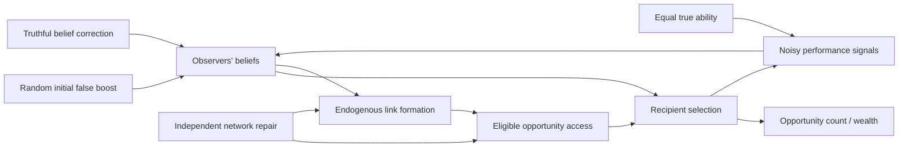

# Experiment 002 — formal causal model and computational specification

**Status:** falsifiable design proposal. Not implemented, run, preregistered, or demonstrated to be novel. All numeric parameters below are *illustrative V0 development defaults* and must not be used as post hoc confirmatory choices.

## Question and causal claim

A reputational system can choose who receives opportunities. Those choices may also restructure who can **see and select** whom. If beliefs are subsequently corrected, the unequal graph may preserve unequal access. We seek to isolate this **pathway through access**, rather than mistake accumulated wealth for continued discrimination.

### Proposed causal graph

`B` is randomized within society; `I` and `S` are assigned **after the exact same preintervention journal**, via a four-branch fork. `Q` is fixed to the same value for all agents in the primary experiment. The graph contains dynamic feedback: selection determines whose outcomes are observed; observation changes beliefs; beliefs shape future access. There is no inherent difference in productivity, and opportunities arise at one per accepted step.

## Actors and state

- **N=20** agents `i=0..19`; each serves as both a *candidate recipient* and an *opportunity allocator/observer*. There are no true status or ability differences.
- Every candidate has true quality `q_i=q0=0.5`; `q0` means chance of a successful observable task *conditional on receiving an opportunity*, not wealth or deservingness.
- Wealth/resource count `w_i(0)=10` for all; one accepted opportunity adds one integer token to its recipient. A success indicator does **not** change token earnings in V0.
- Directed opportunity graph `A_{ji}∈{0,1}` is a record of which candidate `i` allocator `j` can select. No self-edges. Each allocator has exactly `d=4` outgoing candidates throughout V0 (the complete-graph baseline 4 is the one exception, with `d=N−1`). In-degree can vary.
- Each allocator keeps a separate belief `R_{ji,t}∈[0,1]` about candidate `i`'s latent quality, including agents outside the current neighborhood.
- Randomly assign ten of the twenty candidate labels to `B_i=+1` (misleadingly favored) and the rest to `B_i=-1`. This assignment is **independent** of graph positions and of future performance outcomes.
- The initial graph is drawn **uniformly at random** from balanced d-regular directed graphs (in- and out-degree d, no self-loops or duplicate links; for example configuration pairing with rejection) using the `setup` stream, so topology itself varies across seeds rather than being one relabeled lattice. At genesis the repair graph `A*` used by arms S and IS is drawn the same way and stored in the world state, unused until τ (a fork intervention can only mutate world state; see below). Initial beliefs `R_{ji,0}=q0+δ B_i` with illustrative `δ=0.2`; therefore everyone is truly equally able but perceptions differ.

**Important:** initial labels `B_i` are randomized misinformation, *not* protected categories, true skill, early wealth, or post-hoc indicators chosen from outcomes.

## Timing and transition algorithm

Fix the order of operations in each accepted step `t=1..T`:

1. Sample allocator `j` uniformly from all N. In Hiyal this is the engine-owned scheduler in `Scheduling::Random` mode (one uniform draw from its `scheduler` stream), not a policy stream.
2. Define eligible set `E_j(t)={i:A_{ji,t}=1}`; it must have exactly d distinct non-self recipients.
3. Select recipient `i∈E_j(t)` with probability:
   `p(i|j,t) = ε/d + (1−ε) × exp(β R_{ji,t}) / Σ_{k∈E_j(t)} exp(β R_{jk,t})`.
   Illustrative `ε=0.1` and `β=4`. Compute softmax stably by subtracting its maximum log weight; use a deterministic bounded draw from the named `selection` stream. `β=0` is an exact equal-probability negative control.
4. Add one wealth token to the selected `i`; record that accepted opportunity and its allocation, actor IDs, graph and belief revision identifiers. `Σw_i(t)=N×10+t`.
5. Draw an independent performance signal `Y_{i,t}~Bernoulli(q0)` using a named **performance** RNG stream. Only observing allocator `j` updates the selected candidate's score: `R_{ji,t+1}=(1−λ)R_{ji,t}+λY_{i,t}`, illustrative `λ=0.1`. Every other belief remains unchanged. Signals are unbiased; exposure is endogenously selected.
6. At designated preintervention rewiring steps `t≡0 mod m`, illustrative `m=10`, draw a rewiring allocator `r` uniformly from all N using the `rewiring` stream (independent of step 1's allocator `j`). Remove `r`'s currently lowest-belief neighbor (ties broken by a `rewiring` draw), then add one candidate that is not currently a neighbor of `r`, not `r` itself and not the candidate just removed, with probability proportional to `exp(κ R_{ri})`; illustrative `κ=6`. `κ` weights only the *addition*; removal is always by lowest belief (see [open decision D4](design-review-and-tests.md#open-design-decisions)). Outdegree d is invariant and no replacement creates a duplicate link. **No rewiring after the intervention checkpoint** in the current draft; [open decision D1](design-review-and-tests.md#open-design-decisions) explains why this makes H1 close to true by construction.

At the fixed checkpoint `τ=200` accepted opportunities, first checkpoint Hiyal state **before** any intervention. Fork **four branches with identical preintervention state, namespaced RNG state and outcomes**; both information and structural changes occur in one atomic fork policy transition. Hiyal's `fork_at_head` passes the intervention only the world state, and `verify_fork` requires each branch's RNG stream positions to equal the parent's, so an intervention cannot draw random numbers: graph repair installs the pre-drawn `A*`. Continue each fork until `T=600` for a postintervention window of 400 accepted opportunities. Conditional signal draws may diverge across arms; do not pretend action-level random draws remain identical.

## Postintervention factorial design

| Branch | Correct beliefs? | Independently repair graph? | Semantics |
| --- | --- | --- | --- |
| U — sham | No | No | Retain posthistory reputations and unequal links |
| I — information-only | Yes | No | Set **all** observers' candidate beliefs to the true value q0; retain existing opportunity links |
| S — structure-only | No | Yes | Restore a newly sampled balanced d-regular opportunity graph; retain perceptions |
| IS — combined | Yes | Yes | Correct all beliefs and repair the opportunity graph |

For **S and IS**, install **the same** pre-drawn balanced graph `A*` (sampled at genesis from the `setup` stream, independent of `B`, quality signals and rewards). Recreate candidate exposure without using `B`, wealth or observed outcomes. Each branch's postintervention belief updates then follow the common V0 rule. For sham, also perform the same accounting/control-event framework but do not change state, so overhead differences do not silently alter the step horizon.

An ideal global truth correction is intentionally strong and not an empirically plausible rumor-debunking rate. Partial coverage, delayed correction, imperfect credibility, continued graph rewiring and multiple quality levels are **separate later extensions**, not hidden in V0.

## Preintervention baselines

We need multiple **distinct families**; these are not among the four postintervention branches of the same history:

1. **No misinformation:** set `δ=0`; observe whether spurious disparities arise from stochastic variation alone.
2. **No reputation effect on allocation:** `β=0`; recipients uniform within eligible neighborhoods. If rewiring still uses beliefs this is a topology-only mechanism, not an overall null.
3. **No reputation-based rewiring:** `κ=0` **and disable adaptive removal** (keep the original balanced regular graph). Test whether perfect information correction eliminates expected **new** advantage without topology history.
4. **No network dependence:** complete graph of all other actors, fixed and symmetric; tests correction in unrestricted mixing. This changes three things at once: `d` becomes N−1=19 (softmax and ε act over 19 candidates, so each candidate's ε/d floor falls from 0.025 to about 0.005), and rewiring becomes impossible. Differences from the d=4 runs cannot be attributed to network restriction alone; see [open decision D5](design-review-and-tests.md#open-design-decisions) for a d-matched alternative.
5. **No learning/no noise:** disable performance updates, `λ=0`; diagnostic isolation of false prior propagation. This is not the empirically preferred version.
6. **Original wealth-feedback urn:** Experiment 001 is a separate known reference model, not mathematically equated to reputation-mediated dynamics.

Negative-control conditions should not be collapsed into a single all-off case; each tests a different pathway. Always publish null and negative outcomes.

## Formal hypotheses (candidate, NOT registered)

- **H1 (irreversible access):** with reputation-driven rewiring, truthful correction alone can leave positive association between randomized **false-boost labels** and the *future flow* of opportunity tokens even when all true qualities equal.
- **H2 (structural remedy):** after the same preintervention history and identical information correction, repairing the selection graph lowers the **postintervention false-boost opportunity gap** relative to correction alone.
- **H3 → exact symmetry check, not a hypothesis:** when the preintervention graph is balanced, fixed and independent of `B` (no rewiring), perfect correction resets every belief, allocation does not depend on wealth, and post-τ signals are unbiased, so the whole post-τ process is independent of `B` and `E[D_I]=0` exactly; no mixing assumption is needed. Finite runs deviate randomly, but a stable nonzero gap can only be an implementation error, never evidence of another mechanism.
- **H4 (conditional, exploratory):** correction and repair may interact non-additively depending on signal reliability, rewiring rate and the fraction of links preserved. No a priori universal phase transition is assumed.

**Competing explanation:** unbiased noisy performance signals may allow reputation beliefs to self-correct without graph repair; a corrected network may recover without intervention if rewiring continues. The protocol *must* allow H1 and H2 to be rejected, including when the sign reverses.

## Estimands that avoid legacy-wealth confounding

Let `K_i^{z}=w_i^{z}(T)−w_i(τ)` be *new tokens during the postintervention window* in fork z. With equal-sized randomized boost groups:

`D_z = (Σ_{i:B_i=+1} K_i^z − Σ_{i:B_i=−1} K_i^z)/(T−τ)`.

`D_z∈[-1,1]`, equals 0 if each group receives exactly half the new opportunities, and is **not** the historical stock of wealth or a post-hoc grouping.

- **Primary candidate:** `θ = E_seed[D_I − D_IS]`. A positive θ means graph repair lowers the **false-prior advantage that survives complete belief correction**. The contrast is paired on the same prehistory; it identifies this within-model intervention effect.
- **Caution — θ is currently degenerate:** in IS every belief is reset and `A*` is independent of `B`, so the post-τ process is label-symmetric and `E[D_IS | parent]=0` exactly. θ therefore equals `E[D_I]`, H2 restates H1, and subtracting an independent zero-mean `D_IS` roughly doubles `Var(θ̂)`. See [open decision D2](design-review-and-tests.md#open-design-decisions).
- **Mechanistic prerequisite:** `E_seed[D_I]>0` at positive reputation-driven rewiring; if it is zero, calling a positive θ “breaking lock-in” would be misleading.
- **Secondary:** correction-only `E[D_U−D_I]`; structural-only `E[D_U−D_S]`; factorial interaction `E[D_U−D_I−D_S+D_IS]`; post-window allocation Gini, cumulative wealth Gini, graph in-degree/boost correlation, and rank persistence measured from τ.
- **Negative controls:** `E[D_I]=0` in expectation (exactly, by label symmetry) in no-misinformation/no-rewiring balanced-graph cases. Use tolerance/precision rules defined before confirmation, not exact equality in finite runs.

The statistical experimental unit is the **preintervention parent society**. Four fork outcomes, individual agents, and time steps are dependent within parent; cluster/pair bootstrap and inference only across independent parent seeds.

## Implementation and data integrity requirements

- Full model state comprises `(wealth, beliefs R, directed graph A, pre-drawn repair graph A*, boost labels B, accepted_step)` plus the named RNG streams: Hiyal's engine-owned `scheduler` (allocator choice, step 1), `selection` (recipient draw, step 3), `performance` (signals, step 5), `rewiring` (rewiring allocator, tie-breaks and additions, step 6) and `setup` (label permutation, initial graph and `A*`, genesis only). There is no reward stream: a token is a deterministic +1. Interventions are logged fork mutations. No hidden inference calls or nondeterministic unordered iteration.
- Emit exact seed, random-stream labels, Hiyal/lab revisions, model schema and full parameter digest; archive every fork ancestry, initial false-label permutation, preintervention event journal, intervention delta, postintervention actions and original signals.
- Verify invariant outdegree d, no self/duplicate links, q_i equal, score bounds [0,1], balanced initial boost groups, every action recipient eligible at that exact pre-event graph, one token/event, fork-identity and replay/checkpoint equivalence.
- Independent **model reference** and algebraic checks: β=0 equal-probability within a fixed eligibility set; β=κ=0 (and no rewiring) yields label symmetry; graph repair creates balanced exposure independent of boosted labels.
- Per-run provenance must not reveal pseudorandom stream values that make confirmatory seeds predictable *before* public preregistration while obscuring outcomes; commit hashed registration materials before confirmatory analysis, then release seeds and full data afterward.
- For the final human-facing research claim, construct validation and ethical approval are outside the simulator and still mandatory.

## Explicit scope of this document

**We have formalized a falsifiable computational study; we have not run it.** Parameters, inferential thresholds and even H1's effect sign are provisional. The prior literature review does **not** establish novelty. Nothing in this protocol is evidence about actual unequal treatment of people.
