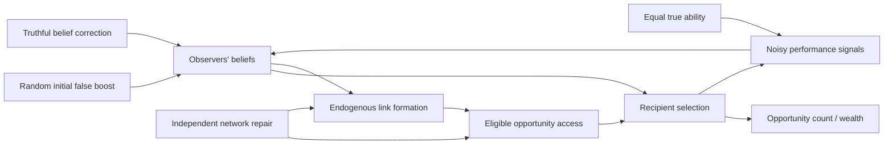

# Experiment 002 — formal causal model and computational specification

**Status:** falsifiable design proposal. Not implemented, run, preregistered, or demonstrated to be novel. All numeric parameters below are *illustrative V0 development defaults* and must not be used as post hoc confirmatory choices.

## Question and causal claim

A reputational system can choose who receives opportunities. Those choices may also restructure who can **see and select** whom. If beliefs are subsequently corrected, the unequal graph may preserve unequal access. We seek to isolate this **pathway through access**, rather than mistake accumulated wealth for continued discrimination.

### Proposed causal graph

`B` is randomized within society; `I` and `S` are assigned **after the exact same preintervention journal**, via a four-branch fork. `Q` is fixed to the same value for all agents in the primary experiment. The graph contains dynamic feedback: selection determines whose outcomes are observed; observation changes beliefs; beliefs shape future access. There is no inherent difference in productivity, and opportunities arise at one per accepted step.

## Actors and state

- **N=20** agents `i=0..19`; each serves as both a *candidate recipient* and an *opportunity allocator/observer*. There are no true status or ability differences.
- Every candidate has true quality `q_i=q0=0.5`; `q0` means chance of a successful observable task *conditional on receiving an opportunity*, not wealth or deservingness.
- Wealth/resource count `w_i(0)=10` for all; one accepted opportunity adds one integer token to its recipient. A success indicator does **not** change token earnings in V0.
- Directed opportunity graph `A_{ji}∈{0,1}` is a record of which candidate `i` allocator `j` can select. No self-edges. Each allocator has exactly `d=4` outgoing candidates throughout V0 (the secondary complete-graph baseline 4b is the one exception, with `d=N−1`). In-degree can vary.
- Each allocator keeps a separate private belief `R_{ji,t}∈[0,1]` about candidate `i`'s latent quality, including agents outside the current neighborhood.
- Each candidate also has one **public reputation** `P_{i,t}∈[0,1]`, shared by all observers. `P_{i,0}=q0+δ B_i` (the false label is public), and every observed signal about `i` updates it (step 5). Private beliefs drive recipient selection and link removal among an allocator's own neighbors; the public reputation drives link *additions*, so the view of a candidate an allocator has never observed can still be corrected by others' observations.
- Randomly assign ten of the twenty candidate labels to `B_i=+1` (misleadingly favored) and the rest to `B_i=-1`. This assignment is **independent** of graph positions and of future performance outcomes.
- **V0 graph generator (exactly uniform):** draw the initial graph uniformly from simple balanced directed d-regular graphs (in- and out-degree d, no self-loops or duplicate links) by **configuration pairing with rejection**: give each agent d out-stubs and d in-stubs, pair them with a uniformly random permutation drawn from `setup/initial_graph`, and redraw the whole pairing if it creates a self-loop or duplicate link. Every simple graph arises from exactly `(d!)^{2N}` pairings, so accepted graphs are exactly uniform. At N=20, d=4 about 1 in 9,000 pairings is accepted (about 0.25 s per graph in a Python check, much faster in Rust), so topology varies across seeds rather than being one relabeled lattice. Construct the pre-drawn repair graph `A*` the same way, but from a separate `setup/repair_graph` substream; draw balanced false-boost labels separately from `setup/labels`. These three setup streams have independently derived named-stream seeds. Both graphs are independent of the random false-boost assignment by construction under the stated pseudorandomness model. Record the complete permutations/labels and RNG positions in the genesis evidence, not merely the final adjacency lists. `A*` stays unused until τ. Initial beliefs `R_{ji,0}=q0+δ B_i` with illustrative `δ=0.2`; everyone is truly equally able. This is a **development graph sampler**, not a claim that sampled social networks resemble those in a population.

**Important:** initial labels `B_i` are randomized misinformation, *not* protected categories, true skill, early wealth, or post-hoc indicators chosen from outcomes.

## Timing and transition algorithm

Fix the order of operations in each accepted step `t=1..T`:

1. Sample allocator `j` uniformly from all N. In Hiyal this is the engine-owned scheduler in `Scheduling::Random` mode (one uniform draw from its `scheduler` stream), not a policy stream.
2. Define eligible set `E_j(t)={i:A_{ji,t}=1}`; it must have exactly d distinct non-self recipients.
3. Select recipient `i∈E_j(t)` with probability:
   `p(i|j,t) = ε/d + (1−ε) × exp(β R_{ji,t}) / Σ_{k∈E_j(t)} exp(β R_{jk,t})`.
   Illustrative `ε=0.1` and `β=4`. Compute softmax stably by subtracting its maximum log weight; use a deterministic bounded draw from the allocator's policy stream `agent/<j>/selection`. `β=0` is an exact equal-probability negative control.
4. Add one wealth token to the selected `i`; record that accepted opportunity and its allocation, actor IDs, graph and belief revision identifiers. `Σw_i(t)=N×10+t`.
5. Draw an independent performance signal `Y_{i,t}~Bernoulli(q0)` from the allocator's policy stream `agent/<j>/performance`, recorded in the action. Only observing allocator `j` updates the selected candidate's score: `R_{ji,t+1}=(1−λ)R_{ji,t}+λY_{i,t}`, illustrative `λ=0.1`. Every other private belief remains unchanged. The same signal updates the public reputation: `P_{i,t+1}=(1−λ_P)P_{i,t}+λ_P Y_{i,t}`, illustrative `λ_P=0.1`. Signals are unbiased; exposure is endogenously selected, so a rarely selected candidate's public reputation corrects slowly.
6. At every rewiring step `t≡0 mod m`, illustrative `m=10`, **before and after τ and in every arm**, draw a rewiring allocator `r` uniformly from all N using the scheduled allocator's policy stream `agent/<j>/rewiring` (the value of `r` is uniform and independent of which `j` drew it). Apply the removal rule `removal∈{lowest_belief, uniform, none}` (default `lowest_belief`): `lowest_belief` removes `r`'s neighbor with the lowest private belief `R_{ri}` (ties broken by an `agent/<j>/rewiring` draw); `uniform` removes a uniformly drawn neighbor; `none` disables rewiring entirely (no removal and no addition), so the graph stays fixed. After a removal, add one candidate that is not currently a neighbor of `r`, not `r` itself and not the candidate just removed, with probability proportional to `exp(κ P_i)` using the public reputation; illustrative `κ=6`. `κ` weights only the addition (`κ=0` makes additions uniform), and `removal` sets the removal channel, so the two vary separately. Outdegree d is invariant and no replacement creates a duplicate link. Because rewiring continues after τ, any lock-in must survive ongoing rewiring, and the self-correction alternative can occur.

**RNG scopes.** Hiyal lets a policy advance only the acting agent's `agent/<id>/…` streams (and the world reducer only `world/…`); any other draw is rejected as an unauthorized stream, at run time and on replay. All per-step draws therefore come from the scheduled allocator's `agent/<j>/…` streams and are recorded in the action, and `World::apply` draws nothing. Forked arms share these stream positions at τ, so draws are paired per agent across arms, although they map to different recipients once neighborhoods differ.

At the fixed checkpoint `τ=200` accepted opportunities, first checkpoint Hiyal state **before** any intervention. Fork **four branches with identical preintervention state, namespaced RNG state and outcomes**; both information and structural changes occur in one atomic fork policy transition. Hiyal's `fork_at_head` passes the intervention only the world state, and `verify_fork` requires each branch's RNG stream positions to equal the parent's, so an intervention cannot draw random numbers: graph repair installs the pre-drawn `A*`. Arms differ only in this fork mutation; afterwards every arm runs the same transition rules, including rewiring. Continue each fork until `T=600` for a postintervention window of 400 accepted opportunities. Conditional signal draws may diverge across arms; do not pretend action-level random draws remain identical.

## Postintervention factorial design

| Branch | Correct beliefs? | Independently repair graph? | Semantics |
| --- | --- | --- | --- |
| U — sham | No | No | No state change; rewiring continues as in every arm |
| I — information-only | Yes | No | Set **all** private beliefs and every public reputation to the true value q0; retain existing opportunity links |
| S — structure-only | No | Yes | Install the pre-drawn balanced d-regular graph `A*`; retain beliefs and public reputations |
| IS — combined | Yes | Yes | Correct all beliefs and public reputations, and install `A*` |

For **S and IS**, install **the same** pre-drawn balanced graph `A*` (sampled at genesis from the `setup/repair_graph` substream, independent of `B`, quality signals and rewards). Recreate candidate exposure without using `B`, wealth or observed outcomes. Each branch's postintervention belief updates then follow the common V0 rule. For sham, also perform the same accounting/control-event framework but do not change state, so overhead differences do not silently alter the step horizon.

An ideal global truth correction is intentionally strong and not an empirically plausible rumor-debunking rate. Partial coverage, delayed correction, imperfect credibility, partial graph repair and multiple quality levels are **separate later extensions**, not hidden in V0.

## Preintervention baselines

We need multiple **distinct families**; these are not among the four postintervention branches of the same history:

1. **No misinformation:** set `δ=0`; observe whether spurious disparities arise from stochastic variation alone.
2. **No reputation effect on allocation:** `β=0`; recipients uniform within eligible neighborhoods. If rewiring still uses beliefs this is a topology-only mechanism, not an overall null.
3. **No reputation-based rewiring:** (3a) `removal=none`: the original balanced graph stays fixed throughout, so correction must eliminate expected **new** advantage without topology history; (3b) `removal=uniform`, `κ=0`: random rewiring at the same churn rate, the matched baseline for separating reputation-driven rewiring from rewiring as such.
4. **No network dependence (d-matched, primary):** at every step allocator `j`'s eligible set is a fresh uniform draw of d distinct non-self candidates from the allocator's `agent/<j>/mixing` stream, i.e. an annealed uniform d-candidate choice set (not a globally d-regular graph): the same outdegree-sized choice set and ε floor as the main model, with no persistent edges or rewiring. In-degrees are not constrained for these per-step samples.
   (4b, secondary) **Complete graph** of all other actors, fixed and symmetric. This changes three things at once: `d` becomes N−1=19 (softmax and ε act over 19 candidates, so each candidate's ε/d floor falls from 0.025 to about 0.005), and rewiring becomes impossible, so its differences from the d=4 runs cannot be attributed to network restriction alone.
5. **No learning/no noise:** disable performance updates, `λ=0`; diagnostic isolation of false prior propagation. This is not the empirically preferred version.
6. **Original wealth-feedback urn:** Experiment 001 is a separate known reference model, not mathematically equated to reputation-mediated dynamics.

Negative-control conditions should not be collapsed into a single all-off case; each tests a different pathway. Always publish null and negative outcomes.

## Formal hypotheses (candidate, NOT registered)

- **H1 (posttruth late gap; primary):** despite perfect information correction and ongoing rewiring, the late post-τ gap `E_parent[D_I^late]` (accepted steps 501–600) remains positive **and is not carried solely by links surviving from τ**. Split the exposure term `g^deg` into links present at τ and still present (`g^inh`) and links added after τ (`g^new`); H1 requires the late-window mean of `g^new + g^sel` to be positive as well. A late gap carried only by surviving τ-links is classified as **slow relaxation** (the sparse-rewiring alternative in the [2026 review §F](scientific-review-2026.md)), not lock-in. A positive full-window gap alone is **not** evidence of irreversibility, and a late gap that vanishes or reverses refutes directional persistence for the specified parameters.
- **H2 (structural repair without correction):** after the same preintervention history and with no belief correction, installing `A*` reduces the magnitude of the post-τ gap: `abs(E[D_S]) < abs(E[D_U])`, judged by magnitude rather than sign, so a reversed gap that repair removes counts as a repair benefit. The repair-after-truth contrast `E[D_I^late − D_IS^late]` is **not** used: under the exchangeability null it equals `E[D_I^late]`, so it would restate H1 (see estimands).
- **H3 → symmetry-null check, not a research hypothesis:** when the graph is balanced, fixed and independent of `B` (`removal=none`), full correction resets all beliefs and public reputation, decisions do not read historical wealth or false labels, and future RNG/exogenous signals are exchangeable, the expected opportunity gap is `E[D_I]=0` **over randomized labels and worlds**. Individual seeds deviate, but a mean across parent societies that differs from zero beyond a prespecified Monte Carlo tolerance **invalidates the run** as an implementation or setup error (for example a label-indexed tie-break); it is never evidence of a mechanism.
- **H4 (conditional, exploratory):** correction and repair may interact non-additively depending on signal reliability, rewiring rate and the fraction of links preserved. No a priori universal phase transition is assumed.

**Competing explanation:** unbiased noisy performance signals may allow reputation beliefs to self-correct without graph repair; a corrected network may recover without intervention if rewiring continues. The protocol *must* allow H1 and H2 to be rejected, including when the sign reverses.

## Estimands that avoid legacy-wealth confounding

Let `K_i^{z}=w_i^{z}(T)−w_i(τ)` be *new tokens during the postintervention window* in fork z. With equal-sized randomized boost groups:

`D_z = (Σ_{i:B_i=+1} K_i^z − Σ_{i:B_i=−1} K_i^z)/(T−τ)`.

`D_z∈[-1,1]`, equals 0 if each group receives exactly half the new opportunities, and is **not** the historical stock of wealth or a post-hoc grouping.

- **Primary:** `E_parent[D_I^late]`, the signed boost-group share difference in the information-only arm over **accepted steps 501–600** (the last 100 of 400 post-τ events), with the H1 requirement that the late-window mean of `g^new + g^sel` is also positive. A 100-event window has a per-run binomial SD of about 0.10 (about 0.05 for the full 400), which pilot precision must account for. It is a conditional *synthetic-model* quantity; inference details are not preregistered.
- **Persistence diagnostics (not co-primary):** full-window `E[D_I]`, four **nonoverlapping 100-event** post-τ windows, and the per-step conditional expectations attributable to **inherited links** (`g^inh`), **post-τ links** (`g^new`) and **belief-mediated selection** (`g^sel`). These decompose the pre-event *expected* gap; a sampled realized gap also contains sampling noise and alone cannot reveal which channel caused it.
- **Repair contrast (H2):** `E_parent[D_U − D_S]`, paired within parent: structural repair *without* correcting misinformation, judged by magnitude. It is not degenerate, because `S` keeps the false beliefs.
- **Exchangeability control:** under properly randomized setup, full belief/public-reputation correction, B-independent graph repair and no hidden B/wealth path in subsequent decisions, `E[D_IS]=0` **in expectation across randomized societies**, not per seed; a mean beyond the Monte Carlo tolerance invalidates the run. This is also why `D_I − D_IS` is not the primary: `E[D_I − D_IS] = E[D_I]` under the null, so it adds no estimand, and because IS runs on an independent `A*` with reset beliefs, `Cov(D_I, D_IS)` is near zero (the arms share only per-agent random draws, which map to different recipients once neighborhoods differ). Hence `Var(D_I−D_IS)=Var(D_I)+Var(D_IS)−2Cov(D_I,D_IS) ≈ 2·Var(D_I)`: about twice the parent societies for the same expectation. The pilot should report the observed covariance.
- **Secondary:** correction-only `E[D_U−D_I]`; factorial interaction `E[D_U−D_I−D_S+D_IS]`, computed directly from all four arms (it equals `E[D_U−D_S]−E[D_I]` only if `E[D_IS]=0` exactly, so do not use that shortcut); post-window allocation Gini, cumulative wealth Gini, graph in-degree/boost correlation, and rank persistence measured from τ.
- **Negative controls:** `E[D_z]=0` in expectation (exactly, by label symmetry) in every arm with no misinformation (`δ=0`), and `E[D_I]=0` with `removal=none`. Use tolerance/precision rules defined before confirmation, not exact equality in finite runs.

**Exact conditional exposure benchmark (must be implemented):** write `b_i=+1/-1`, `p_ji,t` for candidate-selection probability when allocator j is chosen, and `k_i(t)=Σ_j A_ji,t` for recipient in-degree. Under uniform allocator sampling and d outgoing links per allocator, the expected signed boost-group token for the next event satisfies `g_t = (1/N)Σ_jΣ_{i∈E_j} b_i p_ji,t = (Σ_i b_i k_i(t))/(N d) + (1/N)Σ_jΣ_{i∈E_j} b_i(p_ji,t−1/d)`. The first term is **degree/exposure**; the second is **selection**. For `β=0`, the selection term is exactly zero in every state. Split the degree term further into links present at τ and still present (`g^inh`) and links added after τ (`g^new`). Report these pre-event contributions and sampling residual `b_recipient−g_t` for all arms and windows. These identities are mathematical controls, not claims of a novel mechanism. See [critical scientific review](scientific-review-2026.md).

The statistical experimental unit is the **preintervention parent society**. Four fork outcomes, individual agents, and time steps are dependent within parent; cluster/pair bootstrap and inference only across independent parent seeds.

## Implementation and data integrity requirements

- Full model state comprises `(wealth, private beliefs R, public reputations P, directed graph A, pre-drawn repair graph A*, boost labels B, accepted_step)` and the `removal` rule, plus Hiyal's engine-owned `scheduler`, the per-agent policy streams `agent/<j>/selection`, `agent/<j>/performance`, `agent/<j>/rewiring` and `agent/<j>/mixing`, and the genesis-only streams `setup/labels`, `setup/initial_graph` and `setup/repair_graph`. The setup streams' consumed positions must be recorded in the trial's genesis. Hiyal's `Trial::create` builds fresh streams after receiving the world, so this needs a **generic Hiyal genesis-setup API** (for example a `Trial::create_with_setup` that runs a setup closure on the trial's own named streams before writing genesis), added in Hiyal rather than hand-building `Genesis` (schema, trial ID, provenance, stream positions) in lab code, which would copy engine internals. The environment/world reducer must use only the recorded action data: sample signals and rewiring/tie-breaks in the policy and include those decisions in the event action; `World::apply` draws no RNG. There is no reward stream: each committed opportunity deterministically adds one token. Interventions are logged fork mutations. No nondeterministic unordered iteration.
- Emit exact seed, random-stream labels, Hiyal/lab revisions, model schema and full parameter digest; archive every fork ancestry, initial false-label permutation, preintervention event journal, intervention delta, postintervention actions and original signals.
- Verify invariant outdegree d, no self/duplicate links, q_i equal, score bounds [0,1], balanced initial boost groups, every action recipient eligible at that exact pre-event graph, one token/event, fork-identity and replay/checkpoint equivalence.
- Independent **model reference** and algebraic checks: β=0 equal-probability within a fixed eligibility set; β=0 with `removal=none` yields label symmetry; `κ=0` gives uniform addition weights; graph repair creates balanced exposure independent of boosted labels.
- Per-run provenance must not reveal pseudorandom stream values that make confirmatory seeds predictable *before* public preregistration while obscuring outcomes; commit hashed registration materials before confirmatory analysis, then release seeds and full data afterward.
- For the final human-facing research claim, construct validation and ethical approval are outside the simulator and still mandatory.

## Explicit scope of this document

**We have formalized a falsifiable computational study; we have not run it.** Parameters, inferential thresholds and even H1's effect sign are provisional. The prior literature review does **not** establish novelty. Nothing in this protocol is evidence about actual unequal treatment of people.
